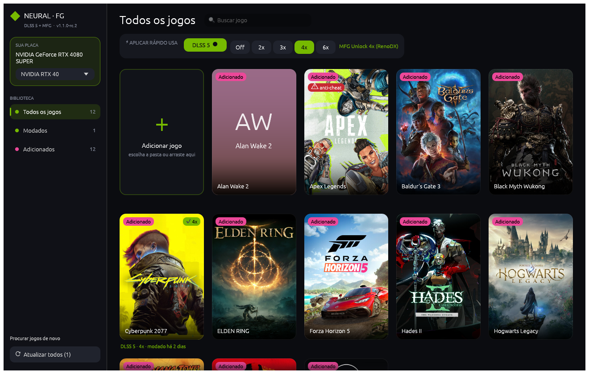
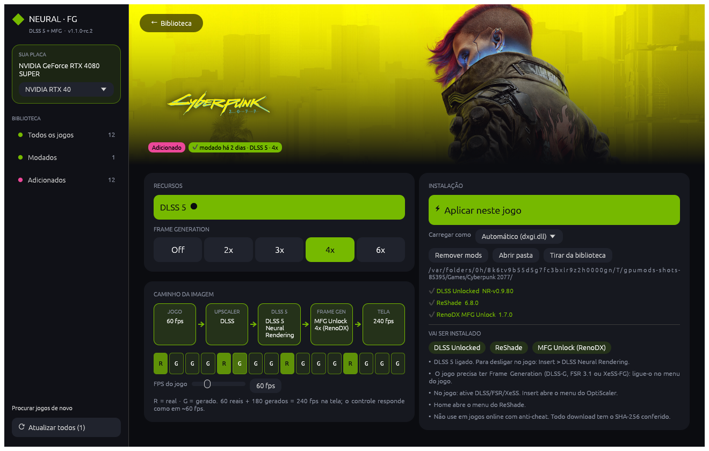

# DLSS 5 + Multi Frame Generation — AMD, NVIDIA e Intel

[](https://github.com/nextestudios/DLSS5-MFG-AMD-NVIDIA/actions/workflows/ci.yml)
[](https://github.com/nextestudios/DLSS5-MFG-AMD-NVIDIA/releases/latest)
[](https://github.com/nextestudios/DLSS5-MFG-AMD-NVIDIA/actions/workflows/sources.yml)
[](LICENSE)

App para Windows que coloca **DLSS 5 (Neural Rendering)** e **Frame Generation de 2x a 6x** em qualquer jogo, em placas **NVIDIA, AMD e Intel**. Você escolhe o jogo; o app detecta a placa, baixa as versões mais novas dos mods mais usados da comunidade, confere o hash de cada arquivo e instala do jeito certo. Um clique desfaz tudo.

*English: a one-click Windows installer for DLSS 5 Neural Rendering and 2x–6x multi frame generation on NVIDIA, AMD and Intel GPUs. It finds your installed games, always fetches the newest community mods (OptiScaler, MFG Unlocker, DLSS Unlocked, NeuralHub…), verifies their SHA-256 and installs or removes them cleanly.*





## Download

Baixe o **`DLSS5-FrameGen.exe`** na [última release](https://github.com/nextestudios/DLSS5-MFG-AMD-NVIDIA/releases/latest). Ele roda direto, sem instalar e sem precisar do Visual C++ Redistributable.

> O `.exe` não é assinado digitalmente: na primeira vez, o Windows SmartScreen pode avisar. Clique em **Mais informações → Executar assim mesmo**. O hash SHA-256 do arquivo vem junto na release.

## Como usar

1. Abra o app. A placa é detectada sozinha e os jogos de Steam, Epic, GOG, Ubisoft, EA, Xbox e Rockstar aparecem na **biblioteca**, com capa.
2. Escolha no topo o que quer: **DLSS 5** e **Frame Generation** (Off, 2x, 3x, 4x, 6x).
3. Aplique de um destes jeitos:
   - **Um clique:** passe o mouse na capa e clique em **⚡ Aplicar**.
   - **Pela tela do jogo:** clique na capa, confira o caminho da imagem e a linha do tempo de quadros e clique em **Aplicar neste jogo**.
   - **Jogo fora das lojas:** clique em **+ Adicionar jogo** e escolha a pasta, ou **arraste a pasta / o `.exe`** para a janela. Ele fica salvo na biblioteca.
4. Se o mod não aparecer no jogo, troque **Carregar como** na tela do jogo (`version.dll`, `winmm.dll`, `winhttp.dll`). A escolha fica salva.
5. Se a pasta for protegida, o app pede permissão de Administrador.
6. No jogo, ative DLSS/FSR/XeSS e o Frame Generation no menu de vídeo.

O app se atualiza sozinho: quando sai uma versão nova, aparece **Atualizar o app** na barra lateral.

**Remover do jogo** apaga só o que o app colocou e devolve os arquivos originais. **Atualizar todos** reinstala, em todos os jogos modados, as mesmas escolhas com as versões mais novas.

## O que cada placa recebe

| Placa | DLSS 5 | Frame Generation |
|---|---|---|
| RTX 50 | DLSS Unlocked | nativo até 4x; 6x via MFG Unlocker |
| RTX 40 | DLSS Unlocked | MFG Unlocker 2x a 6x (com DLSS 5: RenoDX MFG Unlock) |
| RTX 20/30 | DLSS Unlocked | MFG Unlocker 2x a 6x (RTX 20 experimental; com DLSS 5: DLSS-G do DLSS Unlocked) |
| GTX | — | OptiScaler: FSR FG 2x |
| RX 6000/7000/9000 | NeuralHub (instalado e configurado pelo app) | FSR FG 2x; XeSS-FG + MFG Unlocker 3x a 6x (experimental) |
| Intel Arc | — | XeSS-FG + MFG Unlocker 2x a 6x |

### DLSS 5 na AMD

Usa o [NeuralHub (DLSS-NR on AMD)](https://github.com/danielblnc/DLSS-NR-on-AMD). O app instala/atualiza o NeuralHub em modo silencioso, baixa os `nvngx_dlssnr.dll`, `nvngx_dlss.dll`, `nvngx_dlssd.dll` e `nvngx_dlssg.dll` mais novos (só esses arquivos, sem baixar o pacote inteiro) e abre a pasta deles. Dentro do NeuralHub ainda é preciso importar esses DLLs uma vez e clicar em instalar o mod loader no jogo.

## Segurança e como funciona

- **Versão mais nova sempre:** cada componente vem da última release do repositório oficial no GitHub. Sem internet, o app usa a última cópia baixada.
- **Hash conferido:** todo download é comparado com o SHA-256 publicado pelo GitHub; se não bater, o arquivo é apagado e nada é instalado.
- **Reversível:** tudo o que vai para o jogo fica listado em `.gpu-mods-files.txt`; arquivos do jogo substituídos viram `*.gpumods-backup` e voltam ao remover.
- **Estado por jogo:** `.gpu-mods-state.json` guarda a escolha e as versões instaladas.
- Cache em `%LOCALAPPDATA%\GpuMods\cache`.

> ⚠️ **Não use em jogos online com anti-cheat.** DLLs injetadas podem resultar em banimento. O app detecta Easy Anti-Cheat, BattlEye e EA Javelin pelos arquivos do jogo (e pelos perfis) e bloqueia o aplicar até você confirmar que vai jogar offline.

### Perfis por jogo

[`profiles.json`](profiles.json) guarda o que se sabe de cada jogo: anti-cheat, nome de proxy que funciona e dicas. O app baixa a versão mais nova deste repositório (cache de 1 dia) e usa a cópia embutida quando está offline. Para adicionar um jogo, edite o arquivo e abra um PR.

## Componentes usados (baixados das fontes originais)

O app **não redistribui** nenhum desses arquivos: ele baixa de cada projeto na hora da instalação. Cada um tem a própria licença.

| Projeto | Uso |
|---|---|
| [optiscaler/OptiScaler](https://github.com/optiscaler/OptiScaler) e [OptiScaler-nightly](https://github.com/optiscaler/OptiScaler-nightly) | Troca de upscaler e Frame Generation (FSR FG / XeSS-FG) |
| [dashdogy/MFG-Unlocker](https://github.com/dashdogy/MFG-Unlocker) e [dashdogy/OptiScaler](https://github.com/dashdogy/OptiScaler) | Multi Frame Generation 2x–6x |
| [ShyVortex/dlss-unlocked](https://github.com/ShyVortex/dlss-unlocked) | DLSS 5 em RTX 20–50 e origem dos DLLs `nvngx_*` |
| [mavismmg/MFGAdaUnlock-RenoDx](https://github.com/mavismmg/MFGAdaUnlock-RenoDx) | MFG junto com DLSS 5 em RTX 40 |
| [danielblnc/DLSS-NR-on-AMD](https://github.com/danielblnc/DLSS-NR-on-AMD) | DLSS 5 em AMD (NeuralHub) |
| [ReShade](https://reshade.me) | Carregador de add-ons |

Este projeto não é afiliado à NVIDIA, AMD ou Intel. DLSS, FSR e XeSS são marcas de seus donos.

## Compilar

Requer Rust 1.88+.

```sh
cargo test                       # testes de lógica (rodam em qualquer sistema)
cargo test -- --ignored          # baixa e extrai os pacotes reais
cargo build --release            # no Windows
cargo xwin build --release --target x86_64-pc-windows-msvc   # do macOS/Linux
```

## Testes e qualidade

- `cargo test`: 50 testes rápidos, sem internet. Cobrem todas as combinações de placa × DLSS 5 × multiplicador, o download parcial de zip (contra um servidor HTTP local), backup e remoção, leitura das lojas e a interface.
- `cargo test -- --ignored`: baixa os pacotes reais, aplica num jogo falso (RTX 40, RX 7000, GTX, Intel), reinstala e remove, conferindo que nada sobra.
- `DLSS5-FrameGen.exe --smoke-test relatorio.txt`: teste de fumaça do `.exe` final, sem janela (placa, lojas, perfis, planos e um aplicar/remover real).
- CI no Windows a cada push e PR (clippy `-D warnings`, testes e o teste de fumaça do `.exe`); toda semana o workflow **Fontes externas** roda os testes com os pacotes reais e avisa se algum mod mudou.

## Releases

Versões seguem SemVer e o [CHANGELOG](CHANGELOG.md). `scripts/release.sh X.Y.Z` prepara a versão e a tag; o GitHub Actions publica o `.exe`, um zip com a documentação, `SHA256SUMS.txt` e o atestado de procedência. Detalhes em [RELEASING.md](RELEASING.md). Contribuições: [CONTRIBUTING.md](CONTRIBUTING.md) · Segurança: [SECURITY.md](SECURITY.md).

## Estrutura

| Arquivo | O que faz |
|---|---|
| `src/gpu.rs` | Detecta a placa (DXGI) e classifica a geração |
| `src/games.rs` | Lê as bibliotecas de Steam, Epic, GOG, Ubisoft, EA, Xbox e Rockstar |
| `src/plan.rs` | Decide o que instalar para cada placa e escolha (lógica pura, testada) |
| `src/net.rs` | Releases do GitHub, cache, SHA-256 e extração parcial de zip por HTTP |
| `src/install.rs` | Instala, faz backup, edita INIs, remove e atualiza |
| `src/art.rs` | Capas, fundo e logo dos jogos (CDN da Steam) |
| `src/profiles.rs` | Perfis por jogo e detecção de anti-cheat |
| `src/update.rs` | Atualização automática do app |
| `src/smoke.rs` | Teste de fumaça do `.exe` |
| `src/main.rs` | Interface (egui) |

Próximos passos em [PLANO-MELHORIAS.md](PLANO-MELHORIAS.md). Mudanças em [CHANGELOG.md](CHANGELOG.md).

## Licença

[MIT](LICENSE) © 2026 Nexte Studios
